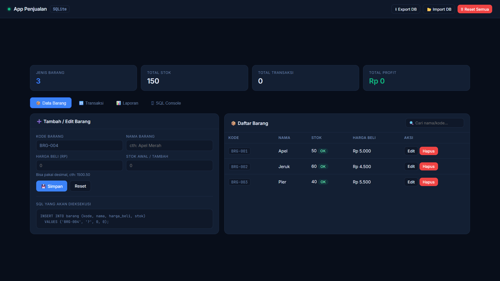
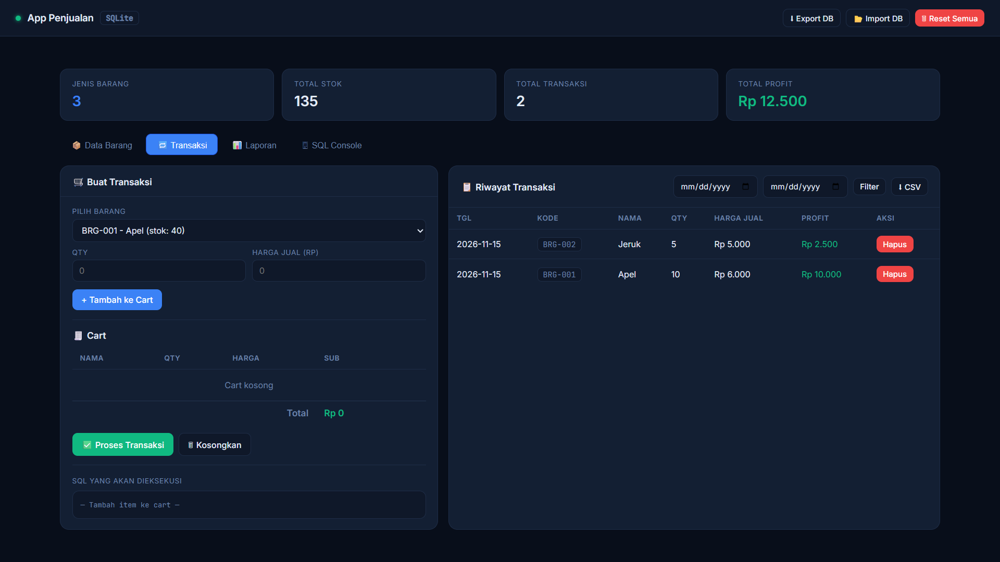
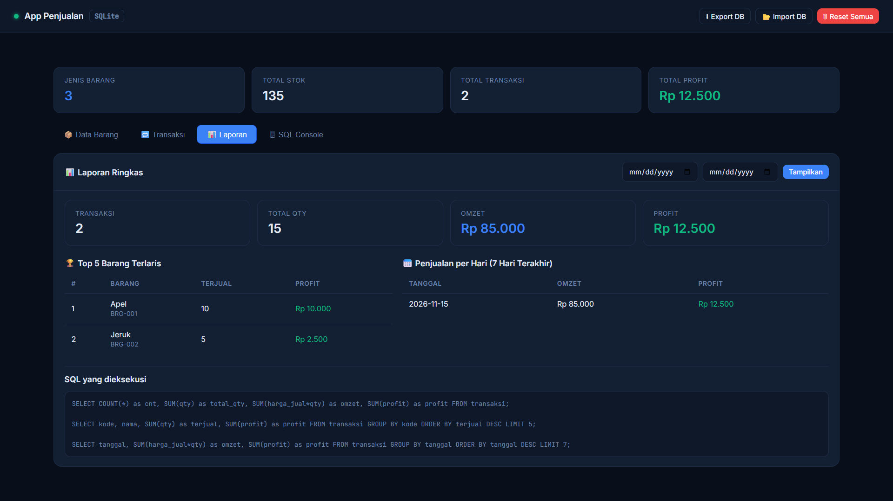

# App Penjualan — SQLite

Aplikasi pencatatan penjualan sederhana yang berjalan sepenuhnya di browser
dalam satu file HTML, tanpa backend dan tanpa instalasi. Data disimpan di
database SQLite (sql.js / WebAssembly) dan tersimpan secara lokal di browser. 
https://sabdagusti.github.io/Log-Penjualan/

  
  
  

## Fitur
- 📦 **Data Barang** – tambah, edit, hapus barang, dengan indikator stok menipis/habis
- 🔁 **Transaksi** – keranjang (cart), validasi stok otomatis, hitung profit per item
- 📊 **Laporan** – ringkasan transaksi, total qty, dan profit per periode
- 🖥 **SQL Console** – jalankan query SQL langsung ke database
- 💾 **Backup & Ekspor** – export/import database, ekspor transaksi ke CSV
- 📈 **Dashboard KPI** – jenis barang, total stok, total transaksi, total profit

## Teknologi
HTML, CSS, JavaScript (Vanilla) · SQLite via [sql.js](https://github.com/sql-js/sql.js)

## Cara Pakai
Buka `log_penjualan.html` di browser modern. Tidak perlu instalasi
(membutuhkan koneksi internet untuk memuat sql.js dari CDN).
